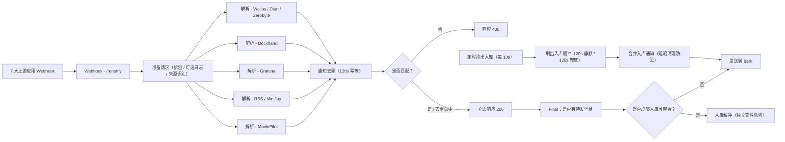

# n8n-webhook-bark-notify

<p align="center">
  <b>一站式多源 Webhook → Bark 智能通知转发工作流（n8n）</b><br />
  内置 7 大自托管服务原生美化解析 · 剧集多集入库防抖聚合 · 120 秒幂等去重 · APNs 4KB 安全截断 · 交互式导入向导
</p>

<p align="center">
  
  
  
  
</p>

---

## 为什么做这个工作流？

自托管玩家通常会同时运行 MoviePilot、Miniflux、Grafana、Dockhand、Wallos、Diun、Zerobyte 等多种服务，各自推送通知容易遇到四个痛点：
1. **格式杂乱、缺少重点与图标**：原始告警和 JSON 难以一眼看出关键信息；
2. **连续下载整季剧集疯狂刷屏**：同时入库 10 集就弹出 10 条 Bark 通知；
3. **重复推送与上游报错**：相同内容反复推送，或被过滤后返回 400 导致上游服务误报失败重试；
4. **APNs 超长静默丢弃**：正文过长超过 4KB UTF-8 限制导致 iOS 根本收不到推送。

本工作流通过**单一 Webhook 入口（`/webhook/renotify`）**统一收口，自动识别来源、精美排版、防抖聚合与幂等去重后再送达 Bark。

---

## 架构总览



---

## 支持的通知来源

| 应用来源 | 支持事件与增强亮点 |
| :--- | :--- |
| **MoviePilot** | 订阅（添加 / 完成自动补齐季号 / 真假修改过滤 / 删除）、下载开始、**单集与多集范围入库聚合**（含时长最短/最长/平均统计）、刷流插件、站点私信、体育赛事、通用站内通知；影视海报自动走 Bark `image` 附图 |
| **RSS / Miniflux** | 其乐 Keylol（游戏名 + 关键词 + Steam 头图）、Spotify（艺人/单曲/专辑区分）、PT 风向旗、直播开播、GitHub Releases 与通用 RSS |
| **Dockhand** | 容器 / Stack / 环境事件、批量可更新容器清单、镜像清理完成/失败；内置 `selfh.st` 图标索引 24h 缓存 |
| **Grafana** | 自动区分告警触发（`firing`）与恢复（`resolved`），支持按系统/文件夹关键词自定义图标（`GRAFANA_SYSTEM_ICONS`） |
| **Wallos** | 订阅到期提醒（兼容 `subscriptioninfo` 与 `subscriptionsinfo`） |
| **Diun** | Docker 镜像新版本发布提醒 |
| **Zerobyte** | 备份任务结果通知 |

---

## 3 分钟快速开始（三种交互式导入方式任选其一）

### 方式一：浏览器图形化交互向导（最推荐 · 零依赖可离线打开）
1. 下载或克隆本仓库后，直接用浏览器双击打开 **[docs/setup-guide.html](./docs/setup-guide.html)**；
2. 按向导逐步填写你的 Bark Device Key、n8n 地址与可选参数，点击**一键生成专属工作流 JSON**，再导入 n8n 即可（全程在本地浏览器完成，零数据上传）。

### 方式二：终端交互式问答向导（Node.js 18+）
```bash
node scripts/setup-wizard.mjs
```
按提示回答几个问题，自动生成可直接导入 n8n 的 `workflows/my-webhook-to-bark.json`（已写入 `.gitignore` 防止误提交）。

### 方式三：手动导入与分步检查清单
直接查看 **[docs/IMPORT_GUIDE.md](./docs/IMPORT_GUIDE.md)**，导入 [workflows/webhook-to-bark.json](./workflows/webhook-to-bark.json) 后修改「发送到 Bark」节点的 URL 并激活工作流即可。

---

## 快速连通性验证

激活工作流后，可直接用 `curl` 发送一条带 `"__test": true` 的测试请求（会自动带上 `【🧪测试】` 前缀且跳过 120 秒去重）：

```bash
curl -X POST "https://your-n8n.example.com/webhook/renotify" \
  -H "Content-Type: application/json" \
  -d '{"zerobyte_title":"连通性测试","zerobyte_message":"如果你在手机 Bark 收到这条消息，说明工作流已部署成功！","__test":true}'
```

---

## 目录结构

```text
.
├── workflows/
│   ├── webhook-to-bark.json            # 完整脱敏工作流（直接导入 n8n）
│   └── nodes/                          # 14 个独立节点 JSON（方便单节点更新）
├── docs/
│   ├── setup-guide.html                # 零依赖离线浏览器交互式配置与导入向导
│   └── IMPORT_GUIDE.md                 # GitHub 网页版分步导入检查清单
├── scripts/
│   └── setup-wizard.mjs                # 零依赖终端交互式配置向导
├── CHANGELOG.md / CONTRIBUTING.md / SECURITY.md / LICENSE
```

---

## 开源协议

本项目基于 [MIT License](./LICENSE) 开源。
